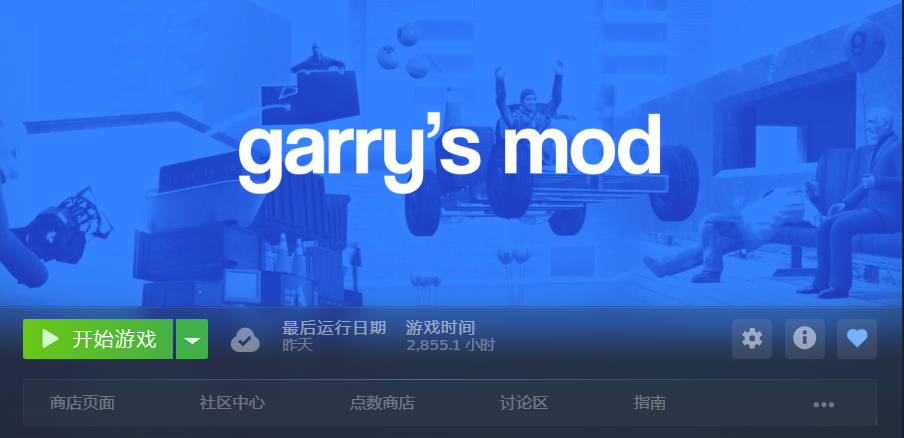

# 对盖瑞模组的介绍
盖瑞老鼠是一款非常好玩的游戏，我已经是一名盖瑞老鼠的资深研究者了(游玩时长方面)

****
本篇是作为 garry'smod 的引入，这款发行于 2006 年的 20 年老游戏，也已经有 20 年的历史了。

第一次接触 gmod 是看到了逆风笑的直播切片，然后我就在互联网上找到了这款游戏的 2008 年版本，然后我就这样玩了一年，后面又接触到 steam，于是就又入正了这款游戏。

说实话，我很少有见过比 gmod 耐玩的游戏了

当然了，开一篇专区给 gmod 也不是只为了分享我与盖瑞老鼠的点点滴滴。
---那太无聊了。没人想看的。**而且我的资料那些都丢失了:(**

我们都知道在互联网上，你总能看见各种各样的奇闻怪事，而互联网又是没有记忆的。
所以很多东西在 10 年后甚至 5 年后，就会变成各种都市传说。
电子游戏（尤其是起源金源引擎游戏），经常成为各种传说的载体。
--比如 xxx 在某个**神秘**的晚上看见某个**神秘**的黑影在某款**神秘**的游戏里，然后就会越传越邪乎

这块 gmod 的分区，除了我对这款游戏的记录外，也会有各种关于这款游戏的怪谈的记录。比如 `rp_downtown 的故事 ` 等

****
首先来简单介绍一下这款游戏，garry'smod
创始人 Garry Newman
英国游戏开发者，出生于英格兰沃尔索尔（Walsall）。他是沙盒游戏《[盖瑞模组](https://baike.baidu.com/item/%E7%9B%96%E7%91%9E%E6%A8%A1%E7%BB%84/3605193?fromModule=lemma_inlink)》（[Garry's Mod](https://baike.baidu.com/item/Garry's%20Mod/7077001?fromModule=lemma_inlink)）的创作者，并创立了独立游戏工作室 [Facepunch Studios](https://baike.baidu.com/item/Facepunch%20Studios/67693559?fromModule=lemma_inlink)

Newman 早期曾从事程序员工作，后利用 [Valve](https://baike.baidu.com/item/Valve/5053718?fromModule=lemma_inlink)的[Source引擎](https://baike.baidu.com/item/Source%E5%BC%95%E6%93%8E/3765836?fromModule=lemma_inlink) 开发了《盖瑞模组》，该模组于 2004 年 12 月 24 日免费发布 。2006 年，该游戏以 9.9 美元的价格在 Steam 平台发售并获得了商业成功
Garry Newman 的开发哲学以赋予玩家高度自由和坚持社区驱动为核心，并且很显然这个理念是十分成功的

> 注:以上内容来自百度百科

****

你如果玩过我的世界的话，你一定对沙盒这个概念不陌生
在沙盒游戏圈子里，一直流传的是：
`如果盖瑞模组敢称老二，没人敢称老大`
因为我的世界虽然也是影响力巨大的沙盒，但是我的世界还是有目标的（击败末影龙）。
盖瑞模组没有，你要做的事情就是打开 steam 自带的创意工坊，然后就像鸡蛋免费领一样疯狂订阅一些东西就可以了
这个游戏最大的乐趣是有人一起玩，所以 facepunch 很贴心的给这个游戏加入了联机功能，你可以在主菜单寻找多人游戏里面找到服务器然后加入进去游玩。
因为盖瑞模组的高自由度，它就有很多奇异搞笑的元素在里面

事实上，马桶人， b 站上那些疯狂的逃跑视频，都是出自这款游戏。
如果你听过逆风笑、手残联盟，那你可能就是一个老资历。
这款游戏的爆火是在 10 年代左右，那个时候的 gmod 是被类似于逆风笑、中国 boy 这种主播带火的。
在后来的爆火是在疫情期间，大家都不能出门就玩这款游戏。

当然上述说的是国内，外网上这款游戏的热度应该挺热的，我也不知道（没了解过）

****
如果你真的真的没听说过这款游戏，我推荐你去入手一下这款游戏（大概打折后 20 多人民币），在这样一个快节奏的时代，真的很少有像 gmod 这样的游戏能让我平静下来.